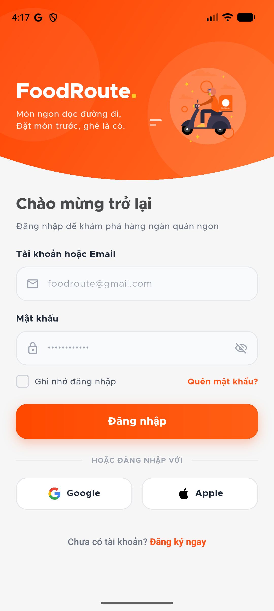
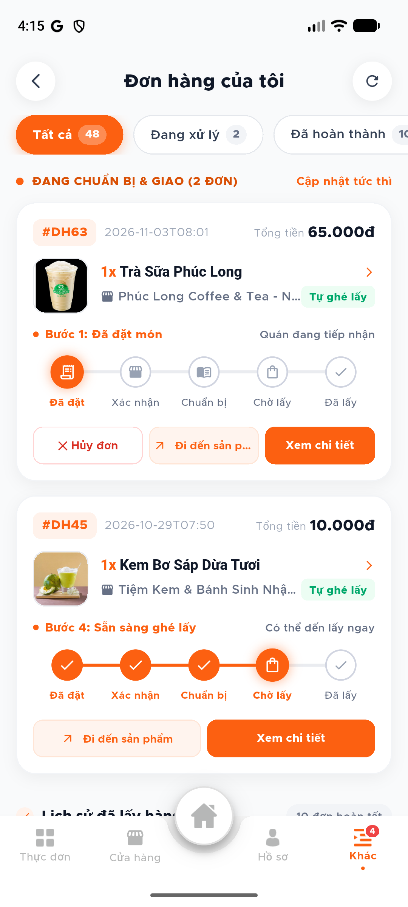
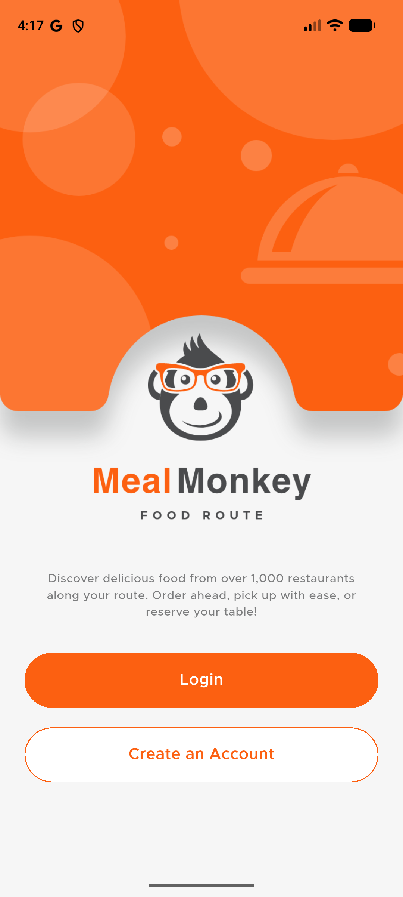

# 🍜 Food Route - Hệ Thống Đặt Thức Ăn Tiện Đường Về & Đặt Bàn Thông Minh
### *(Smart City Route-Corridor Food Discovery & Pre-Order System)*

[](https://flutter.dev)
[](https://dart.dev)
[](https://nodejs.org)
[](https://www.typescriptlang.org)
[](https://react.dev)
[](https://www.postgresql.org)
[](https://postgis.net)
[](https://socket.io)
[](https://payos.vn)
[](https://www.docker.com)

---

## 📌 1. Giới Thiệu Đề Tài (Project Overview)

Trong bối cảnh đô thị hiện đại, nhu cầu ăn uống nhanh gọn sau giờ làm/giờ học tăng cao. Tuy nhiên, các ứng dụng giao hàng truyền thống (Food Delivery) thường gặp các hạn chế:
- **Phí giao hàng cao** trong giờ cao điểm hoặc thời tiết xấu.
- **Thời gian chờ giao hàng lâu** (30 - 45 phút), dễ bị nguội món khi đến nơi.
- **Đi vòng bất tiện:** Khách hàng tự ghé mua thường không biết chính xác quán nào nằm thuận chiều, mất công đi vòng hoặc tốn thời gian đứng chờ chế biến tại quán.

**Food Route** ra đời nhằm giải quyết triệt để vấn đề trên bằng cách kết hợp:
1. **Hành lang không gian (Spatial Route Corridor):** Khách hàng chỉ cần nhập điểm xuất phát (A) và điểm đến (B). Hệ thống tự động tính toán lộ trình tối ưu và quét tìm các nhà hàng/quán ăn uy tín nằm ngay trên hoặc sát tuyến đường di chuyển (độ lệch tuyến chỉ vài chục mét).
2. **Đặt trước tự ghé lấy (Take-away Pre-Order):** Chọn món, hẹn chính xác khung giờ ghé lấy (Pickup Time). Quán chuẩn bị sẵn sàng trước khi khách tới, ghé lấy ngay không cần chờ đợi.
3. **Thanh toán tự động không tiền mặt (VietQR / PayOS):** Tích hợp cổng thanh toán trực tuyến Napas 247 / VietQR động, tự động xác nhận đơn qua Webhook tức thì.
4. **Đặt bàn trực tuyến (Table Reservation):** Hỗ trợ đặt bàn trước cho nhóm bạn hoặc gia đình muốn trải nghiệm ăn tại quán.

---

## 📸 2. Hình Ảnh Minh Họa Thực Tế Hệ Thống (Screenshots Gallery)

### 📱 Ứng Dụng Di Động Khách Hàng (Customer Mobile App - Flutter)

| 1. Khám Phá Tuyến Đường & Hành Lang Quán Ăn | 2. Danh Sách Quán Tiện Đường Ghé Lấy | 3. Thực Đơn & Chi Tiết Nhà Hàng |
| :---: | :---: | :---: |
|  |  |  |
| *Tính toán lộ trình Phan Huy Ích ➔ Bến Thành (10.6 km), quét tìm quán ăn bằng PostGIS* | *Hiển thị độ lệch tuyến chính xác (54m, 393m,...), thời gian chế biến dự kiến* | *Thực đơn phân theo danh mục, quản lý tồn kho và giờ phục vụ tức thì* |

| 4. Chi Tiết Món & Tùy Chọn Đặt Món | 5. Giỏ Hàng & Hẹn Giờ Tự Đến Lấy | 6. Xác Nhận Đơn Pre-Order |
| :---: | :---: | :---: |
|  |  |  |
| *Tùy chọn ghi chú cho quán, định lượng dinh dưỡng (kcal) & thời gian chế biến* | *Lên lịch giờ hẹn nhận món (Pickup Time), phí giao hàng 0đ (tự ghé lấy)* | *Chuẩn hóa phương thức thanh toán chuyển khoản VietQR / PayOS* |

| 7. Thanh Toán Quét Mã VietQR / PayOS | 8. Hộp Thoại Hủy Đơn An Toàn | 9. Theo Dõi Tiến Độ Đơn Hàng Realtime |
| :---: | :---: | :---: |
|  |  |  |
| *Sinh mã VietQR động theo từng đơn hàng (#DH-67), tự động nhận diện thanh toán* | *Giao diện cảnh báo trực quan, chống ấn nhầm và đồng bộ trạng thái an toàn* | *Tiến độ 5 bước trực quan (Đã đặt ➔ Xác nhận ➔ Chuẩn bị ➔ Chờ lấy ➔ Đã lấy)* |

| 10. Màn Hình Đăng Nhập & Thương Hiệu | 11. Quản Lý Lịch Sử Đơn Hàng | 12. Giao Diện Chào Đón & Định Vị |
| :---: | :---: | :---: |
|  |  |  |
| *Xác thực an toàn JWT, phân quyền tài khoản & Google OAuth* | *Danh sách đơn hàng theo tiến trình xử lý, cập nhật realtime qua Socket.io* | *Bộ nhận diện thương hiệu Food Route đồng bộ trên toàn ứng dụng* |

---

## 🌟 3. Tính Năng Nổi Bật (Key Features)

### 📍 1. Tìm Quán Ăn Dọc Tuyến Đường (Smart Spatial Route Corridor)
- Tích hợp định tuyến đường bộ OpenStreetMap / OSRM.
- Sử dụng hàm không gian **PostGIS** (`ST_DWithin`, `ST_DistanceSphere`, `ST_LineLocatePoint`) tạo một **hành lang vùng đệm (Corridor Buffer)** dọc theo polyline di chuyển.
- Tính toán và hiển thị chính xác **khoảng cách lệch tuyến (Detour Distance)** để người dùng biết mình chỉ cần rẽ thêm bao nhiêu mét là tới quán.

### 🛍️ 2. Đặt Trước Ghé Lấy (Take-away Pre-Order) & Hẹn Giờ Linh Hoạt
- Chọn món và chọn chính xác thời điểm muốn ghé lấy món ăn (Pickup Time).
- Phí vận chuyển bằng **0đ**, người dùng chủ động thời gian, thức ăn luôn nóng hổi khi nhận.
- Tích hợp một chạm nút **"Dẫn đường"** mở Google Maps chỉ thẳng tới vị trí cửa hàng.

### 💳 3. Thanh Toán Tự Động Không Tiền Mặt (VietQR / PayOS)
- Tự động sinh mã VietQR động chứa mã đơn hàng và số tiền chính xác qua API PayOS.
- Khách hàng quét mã qua mọi ứng dụng ngân hàng hoặc ví điện tử (Napas 247).
- Hệ thống lắng nghe **PayOS Webhook** để xác nhận đơn hàng sang trạng thái `DA_THANH_TOAN` trong vài giây mà không cần thao tác thủ công.

### ⚡ 4. Đồng Bộ Trạng Thái Realtime 2 Chiều (Socket.io)
- **Tiến trình đơn hàng 5 bước:** `Đã đặt` ➔ `Xác nhận` ➔ `Chuẩn bị` ➔ `Chờ lấy` ➔ `Đã lấy`.
- Khi chủ nhà hàng bấm duyệt đơn hoặc cập nhật món xong trên Web Portal, Mobile App của khách hàng lập tức nhảy trạng thái và phát thông báo tức thì.
- Đồng bộ đánh giá & phản hồi sao trực tiếp giữa khách hàng và hồ sơ nhà hàng.

### 🍽️ 5. Đặt Bàn Trực Tuyến (Online Table Reservation)
- Xem sơ đồ bàn, tình trạng bàn trống theo ngày và khung giờ.
- Đặt bàn trước cho bữa tiệc gia đình, bạn bè; hệ thống khóa giữ bàn tự động tránh trùng lịch.

### 🏢 6. Hệ Thống Web Quản Trị & Cổng Nhà Hàng (Web Portal)
- **Cổng Chủ Nhà Hàng (Restaurant Portal):**
  - Quản lý thực đơn, phân loại món, giá bán, chương trình Flash Sale, mã giảm giá.
  - Bảng điều phối tiếp nhận đơn hàng Take-away và đơn Đặt bàn realtime.
  - Báo cáo doanh thu, lượt đánh giá và thống kê hiệu quả kinh doanh.
- **Cổng Quản Trị Hệ Thống (Admin System):**
  - Kiểm duyệt và cấp quyền cho các nhà hàng đối tác mới tham gia hệ thống.
  - Quản lý người dùng, phân quyền RBAC và tra cứu Audit Logs toàn diện.

---

## 🏗️ 4. Kiến Trúc Hệ Thống (Architecture & Tech Stack)

Dự án được xây dựng theo mô hình **Monorepo** phân tách rõ ràng 3 tầng:

```
datthucan/
├── backend/                   # RESTful API Server & Realtime Engine
│   ├── src/
│   │   ├── config/            # Cấu hình CSDL PostgreSQL & JWT Token
│   │   ├── models/            # 18 TypeORM Entities
│   │   ├── services/          # Logic nghiệp vụ (Route, Order, PayOS, Reservation)
│   │   ├── controllers/       # HTTP Request Handlers
│   │   ├── routes/            # Khai báo Endpoint định tuyến
│   │   ├── middlewares/       # Xác thực JWT & Phân quyền RBAC
│   │   └── database/          # Migrations & Script CSDL
│   └── tsconfig.json
├── mobile/                    # Ứng Dụng Di Động Khách Hàng (Flutter)
│   ├── lib/
│   │   ├── models/            # Data Models (Order, Restaurant, Route, Place)
│   │   ├── providers/         # State Management (MapProvider, CartProvider, etc.)
│   │   ├── services/          # API Client & Socket.io Realtime Client
│   │   ├── screens/ / view/   # Màn hình giao diện khách hàng
│   │   └── widgets/           # UI Components (RouteCard, VietQRModal, etc.)
│   └── pubspec.yaml
├── web/                       # Web Portal Quản Trị & Cửa Hàng (React + Vite)
│   ├── src/
│   │   ├── api/               # API Interceptors & Socket Client
│   │   ├── pages/admin/       # Quản trị hệ thống (Dashboard, Nhà hàng, Người dùng)
│   │   ├── pages/restaurant/  # Cổng chủ quán (Đơn hàng, Đặt bàn, Thực đơn)
│   │   └── context/           # AuthContext & Session Management
│   └── package.json
├── database/                  # Schema CSDL PostgreSQL chuẩn hóa 18 bảng
├── docs/screenshots/          # Kho ảnh chụp giao diện thực tế hệ thống
└── docker-compose.yml         # File điều phối Container Docker
```

### 🛠️ Công Nghệ Sử Dụng

| Thành Phần | Công Nghệ / Thư Viện | Mục Đích Sử Dụng |
| :--- | :--- | :--- |
| **Backend** | Node.js, Express, TypeScript | Xây dựng RESTful API hiệu năng cao |
| **Database** | PostgreSQL 15+, PostGIS | Lưu trữ dữ liệu quan hệ và truy vấn không gian địa lý |
| **ORM** | TypeORM | Ánh xạ thực thể CSDL (18 bảng, `synchronize: false` bảo vệ toàn vẹn) |
| **Realtime** | Socket.io | Truyền phát sự kiện realtime 2 chiều (đơn hàng, đặt bàn, đánh giá) |
| **Payment Gateway** | PayOS SDK (VietQR Napas 247) | Thanh toán trực tuyến tự động qua mã QR động & Webhook |
| **Mobile App** | Flutter 3.x, Dart | Ứng dụng di động đa nền tảng cho khách hàng |
| **Mobile State** | Provider (MVVM Pattern) | Quản lý trạng thái bản đồ, giỏ hàng, thông báo |
| **Web Portal** | React 18, Vite, TypeScript, Tailwind | Giao diện quản trị viên và chủ nhà hàng |
| **Bản đồ & Định vị**| Flutter Map, OpenStreetMap, OSRM | Vẽ polyline lộ trình, hiển thị marker và tính toán trạm dừng |

---

## 🛡️ 5. Nguyên Tắc An Toàn & Bảo Mật Dữ Liệu

1. **Bảo vệ toàn vẹn CSDL (`synchronize: false`):**
   - Không sử dụng `synchronize: true` trên môi trường chạy để tránh rủi ro mất dữ liệu bảng.
   - Toàn bộ 18 bảng CSDL được cập nhật có kiểm soát qua các file migration SQL.
2. **Kiểm soát phân quyền nghiêm ngặt (Role-Based Access Control):**
   - Xác thực bắt buộc qua Access Token JWT tại Header mỗi request.
   - Phân quyền chặt chẽ theo vai trò: `KHACH_HANG`, `CHU_CUA_HANG`, `ADMIN`.
   - Cửa hàng A tuyệt đối không thể xem hoặc chỉnh sửa thực đơn/đơn hàng của Cửa hàng B (Ownership Protection).
3. **Quy chuẩn mã nguồn Clean Code:**
   - Mỗi tệp mã nguồn tuân thủ giới hạn dưới 1000 dòng, mô-đun hóa cao, dễ bảo trì và mở rộng.

---

## 🚀 6. Hướng Dẫn Cài Đặt & Khởi Chạy (Getting Started)

### 📋 Yêu Cầu Môi Trường (Prerequisites)
- **Node.js** >= 18.x
- **Flutter SDK** >= 3.19.x & Android Studio / Android Emulator
- **PostgreSQL** >= 15 (đã kích hoạt extension `postgis`)
- **Docker & Docker Compose** (nếu khởi chạy qua container)

---

### 🔹 Cách 1: Khởi Chạy Nhanh Bằng Docker Compose
```bash
# Clone dự án từ GitHub
git clone https://github.com/TranDuBao/datthucan_trenduongve.git
cd datthucan_trenduongve

# Khởi chạy toàn bộ hệ thống (PostgreSQL + PostGIS + Backend)
docker-compose up -d --build
```

---

### 🔹 Cách 2: Khởi Chạy Thủ Công Từng Thành Phần

#### 1. Khởi chạy CSDL & Backend Server
```bash
cd backend
npm install

# Tạo file cấu hình môi trường (.env) dựa theo cấu hình CSDL của bạn
# DB_HOST=localhost, DB_PORT=5432, DB_NAME=datthucan, DB_USER=postgres, DB_PASSWORD=...

# Chạy server ở chế độ phát triển
npm run dev

# Backend sẽ lắng nghe tại: http://localhost:3000
```

#### 2. Khởi chạy Web Portal (Admin & Quản Lý Nhà Hàng)
```bash
cd web
npm install

# Khởi chạy Vite dev server
npm run dev

# Truy cập Web Portal tại: http://localhost:5173
```

#### 3. Khởi chạy Flutter Mobile App
```bash
cd mobile
flutter pub get

# Kiểm tra thiết bị / máy ảo đang kết nối
flutter devices

# Khởi chạy ứng dụng lên máy ảo Android
flutter run
```

---

## 📡 7. Danh Mục API Endpoints Chính

| Phương Thức | Endpoint | Chức Năng | Phân Quyền |
| :--- | :--- | :--- | :--- |
| `POST` | `/api/v1/auth/register` | Đăng ký tài khoản mới (Khách / Quán) | Public |
| `POST` | `/api/v1/auth/login` | Đăng nhập hệ thống (Email + Password) | Public |
| `POST` | `/api/v1/auth/google` | Đăng nhập bằng Google OAuth ID Token | Public |
| `GET` | `/api/v1/restaurant-mgmt/profile` | Xem hồ sơ và giờ hoạt động quán | Cửa hàng |
| `PUT` | `/api/v1/restaurant-mgmt/profile` | Cập nhật thông tin & tọa độ quán | Cửa hàng |
| `GET` | `/api/v1/restaurant-mgmt/menu` | Danh sách thực đơn & món ăn của quán | Cửa hàng |
| `POST` | `/api/v1/restaurant-mgmt/menu` | Thêm món ăn mới vào thực đơn | Cửa hàng |
| `GET` | `/api/v1/orders` | Danh sách đơn hàng cá nhân | Khách hàng |
| `POST` | `/api/v1/orders` | Tạo đơn hàng đặt trước (Pre-order) | Khách hàng |
| `POST` | `/api/v1/payments/payos/create` | Tạo liên kết thanh toán VietQR / PayOS | Khách hàng |
| `POST` | `/api/v1/payments/payos/webhook` | Webhook nhận diện thanh toán tự động | Public / PayOS |
| `GET` | `/api/v1/restaurant/reservations` | Danh sách đơn đặt bàn & sơ đồ bàn | Cửa hàng |
| `POST` | `/api/v1/restaurant/reservations/:id/confirm` | Xác nhận đơn đặt bàn của khách | Cửa hàng |
| `GET` | `/api/v1/admin/dashboard` | Thống kê số liệu toàn hệ thống | Quản trị viên |
| `GET` | `/api/v1/admin/restaurants` | Danh sách & phê duyệt đối tác mới | Quản trị viên |
| `GET` | `/api/v1/admin/users` | Quản lý người dùng & phân quyền RBAC | Quản trị viên |

---

## 👨‍💻 8. Thông Tin Tác Giả & Đồ Án Tốt Nghiệp

- **Đề Tài:** Ứng Dụng Tối Ưu Lộ Trình Đặt Đồ Ăn & Mua Sắm Tiện Đường Về (Food Route)
- **Hệ Thống:** Khóa Luận Tốt Nghiệp Ngành Công Nghệ Thông Tin (KLTN)
- **Tác Giả:** Trần Dũ Bảo & Dương Minh Quốc Bảo ([@TranDuBao](https://github.com/TranDuBao) [@DuongMinhQuocBao](https://github.com/Anh3DaoPhay))
- **Mã Nguồn Repository:** [https://github.com/TranDuBao/datthucan_trenduongve](https://github.com/TranDuBao/datthucan_trenduongve)

---
*Dự án được xây dựng với mục tiêu ứng dụng công nghệ đô thị thông minh (Smart City Logistics), giảm thiểu phát thải và tắc nghẽn giao thông thông qua việc tối ưu tuyến đường ghé lấy món ăn.*
