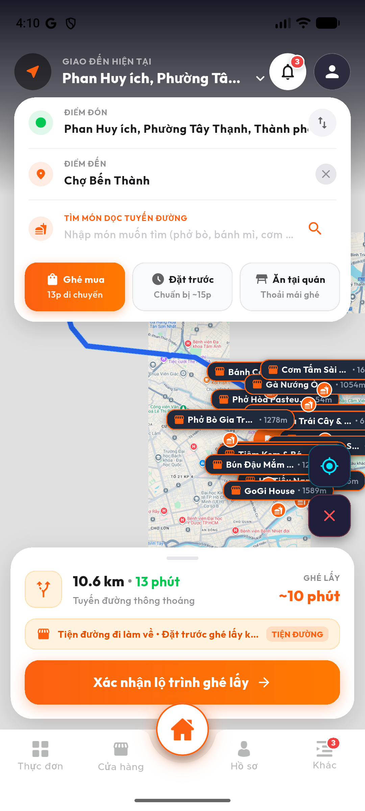
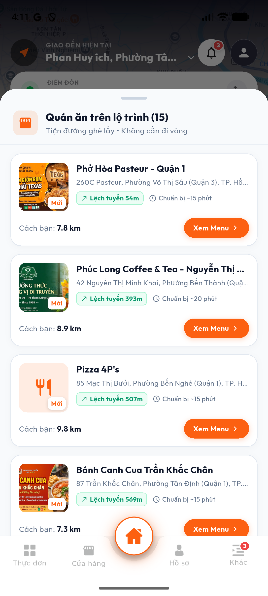
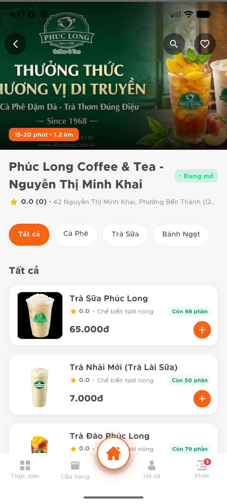
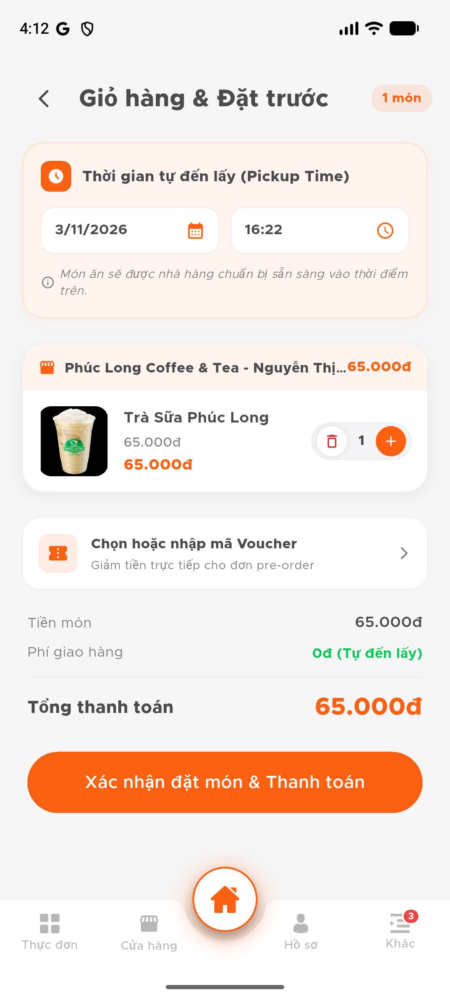
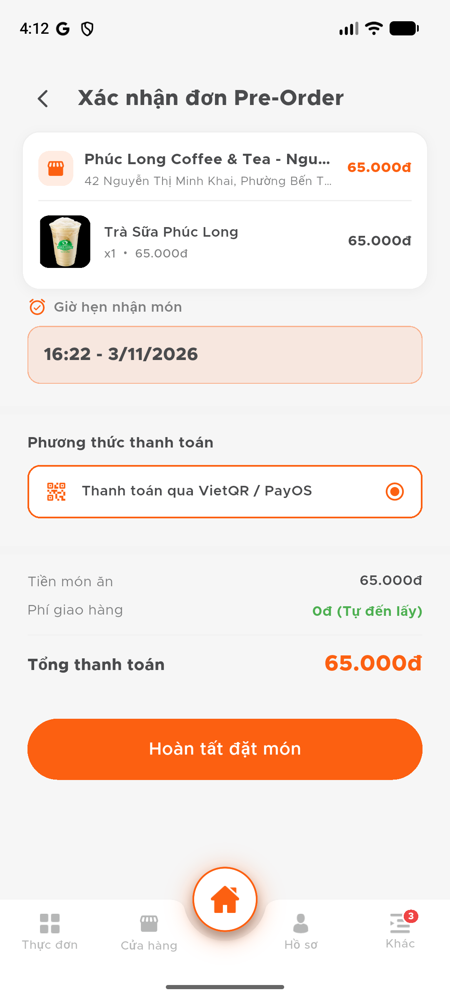
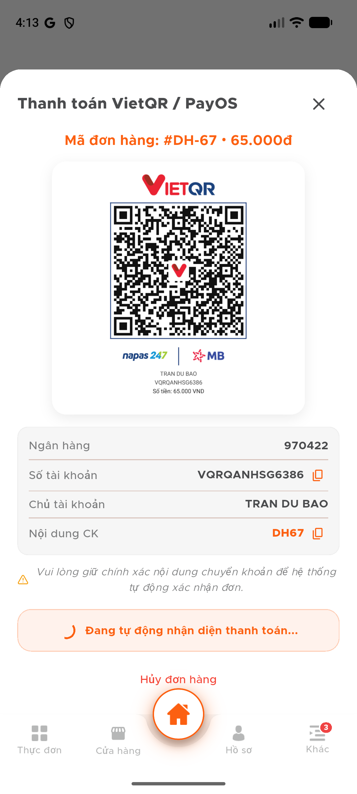
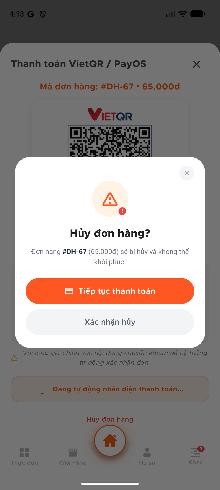
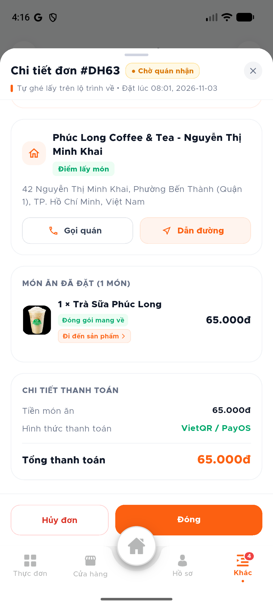

# 🍜 Food Route - Hệ Thống Đặt Thức Ăn Tiện Đường Về & Đặt Bàn Thông Minh
### *(Smart City Route-Corridor Food Discovery, Turn-by-Turn Stopover Navigation & Pre-Order System)*

[](https://flutter.dev)
[](https://dart.dev)
[](https://nodejs.org)
[](https://www.typescriptlang.org)
[](https://react.dev)
[](https://www.postgresql.org)
[](https://postgis.net)
[](https://firebase.google.com)
[](https://socket.io)
[](https://payos.vn)
[](https://www.docker.com)

---

## 📌 1. Giới Thiệu Đề Tài (Project Overview)

Trong bối cảnh đô thị hiện đại, nhu cầu ăn uống nhanh gọn sau giờ làm/giờ học tăng cao. Tuy nhiên, các ứng dụng giao hàng truyền thống (Food Delivery) thường gặp các hạn chế:
- **Phí giao hàng cao** trong giờ cao điểm hoặc thời tiết xấu.
- **Thời gian chờ giao hàng lâu** (30 - 45 phút), dễ bị nguội món khi đến nơi.
- **Đi vòng bất tiện:** Khách hàng tự ghé mua thường không biết chính xác quán nào nằm thuận chiều, mất công đi vòng hoặc tốn thời gian đứng chờ chế biến tại quán.

**Food Route** ra đời nhằm giải quyết triệt để vấn đề trên bằng cách kết hợp:
1. **Hành lang không gian (Spatial Route Corridor):** Khách hàng chỉ cần nhập điểm xuất phát (A) và điểm đến (B). Hệ thống tự động tính toán lộ trình tối ưu và quét tìm các nhà hàng/quán ăn uy tín nằm ngay trên hoặc sát tuyến đường di chuyển (độ lệch tuyến chỉ vài chục mét).
2. **Lộ trình dẫn đường 2 chặng ghé quán (Turn-by-Turn Stopover Guidance):**
   - **Chặng 1 (Cam):** Xuất phát ➔ Quán ghé lấy (thời gian di chuyển, chỉ dẫn từng khúc cua).
   - **Chặng 2 (Xanh lá):** Quán ghé lấy ➔ Điểm đến ban đầu (tiếp tục hành trình về nhà).
   - Tự động hiển thị thẻ đón món, modal chúc ngon miệng và khôi phục giao diện bản đồ tại vị trí GPS ban đầu khi hoàn tất.
3. **Đặt trước tự ghé lấy (Take-away Pre-Order):** Chọn món, hẹn chính xác khung giờ ghé lấy (Pickup Time). Quán chuẩn bị sẵn sàng trước khi khách tới, ghé lấy ngay không cần chờ đợi.
4. **Thanh toán tự động không tiền mặt (VietQR / PayOS):** Tích hợp cổng thanh toán trực tuyến Napas 247 / VietQR động, tự động xác nhận đơn qua Webhook tức thì.
5. **Hệ thống thông báo tức thì (Push Notification & In-App Alerts):** Tích hợp Firebase Cloud Messaging (FCM), thông báo khay hệ thống, màn hình khóa và trung tâm tin nhắn song ngữ.
6. **Đặt bàn trực tuyến (Table Reservation):** Hỗ trợ đặt bàn trước cho nhóm bạn hoặc gia đình muốn trải nghiệm ăn tại quán.

---

## 📸 2. Hình Ảnh Minh Họa Thực Tế Hệ Thống (Screenshots Gallery)

### 📱 Ứng Dụng Di Động Khách Hàng (Customer Mobile App - Flutter)

| 1. Khám Phá Tuyến Đường & Hành Lang Quán Ăn | 2. Dẫn Đường Ghé Quán 2 Chặng Phân Màu | 3. Hướng Dẫn Từng Khúc Cua (Turn-by-Turn) |
| :---: | :---: | :---: |
|  |  |  |
| *Tính toán lộ trình bằng OSRM / OpenStreetMap, quét tìm quán ăn bằng PostGIS* | *Chặng 1 (Cam): Điểm xuất phát ➔ Quán; Chặng 2 (Xanh lá): Quán ➔ Điểm đích* | *Chi tiết từng bước rẽ, ước tính thời gian di chuyển và tình trạng giao thông* |

| 4. Chi Tiết Đơn Hàng & Thẻ Dẫn Đường Ghé Lấy | 5. Modal Chúc Ngon Miệng & Hoàn Tất | 6. Giỏ Hàng & Hẹn Giờ Tự Đến Lấy |
| :---: | :---: | :---: |
|  |  |  |
| *Xem chi tiết đơn hàng ghé lấy trên lộ trình, nút chỉ dẫn tới quán một chạm* | *Xác nhận đã nhận món, chúc quý khách ngon miệng và hoàn tất về lại GPS ban đầu* | *Lên lịch giờ hẹn nhận món (Pickup Time), phí giao hàng 0đ (tự ghé lấy)* |

| 7. Thanh Toán Quét Mã VietQR / PayOS | 8. Hộp Thoại Hủy Đơn An Toàn & Bảo Mật | 9. Trung Tâm Thông Báo Đa Ngôn Ngữ |
| :---: | :---: | :---: |
|  |  |  |
| *Sinh mã VietQR động theo từng đơn hàng, tự động nhận diện thanh toán* | *Giao diện hiện đại, xác nhận hủy có lý do, kiểm tra quyền sở hữu tuyệt đối* | *Push Notification trên thanh trạng thái, màn hình khóa và danh sách tin nhắn in-app* |

---

## 🌟 3. Tính Năng Nổi Bật (Key Features)

### 📍 1. Tìm Quán Ăn Dọc Tuyến Đường (Smart Spatial Route Corridor)
- Tích hợp định tuyến đường bộ OpenStreetMap / OSRM / TomTom.
- Sử dụng hàm không gian **PostGIS** (`ST_DWithin`, `ST_DistanceSphere`, `ST_LineLocatePoint`) tạo một **hành lang vùng đệm (Corridor Buffer)** dọc theo polyline di chuyển.
- Tính toán và hiển thị chính xác **khoảng cách lệch tuyến (Detour Distance)** để người dùng biết mình chỉ cần rẽ thêm bao nhiêu mét là tới quán.

### 🧭 2. Điều Hướng Lộ Trình 2 Chặng & Tự Ghé Lấy (Stopover Turn-by-Turn Guidance)
- **Phân tách 2 chặng màu rõ ràng:**
  - *Chặng 1 (Cam):* Điểm xuất phát $A \to$ Quán ghé lấy $Q$.
  - *Chặng 2 (Xanh lá):* Quán ghé lấy $Q \to$ Điểm đích ban đầu $B$.
- **Thẻ chỉ dẫn thông minh:**
  - Thẻ cố định ở chân bản đồ với 2 chế độ: *Xem hướng dẫn đi* và *Đã lấy món*.
  - Khi đã lấy món: Chuyển sang nút *Hướng dẫn tới quán lại* và *Hoàn tất*.
  - Popup xác nhận *"Chúc Quý Khách Ngon Miệng!"* kèm thông tin quán & mã đơn hàng.
  - Sau khi hoàn tất: Tự động dọn sạch lộ trình và định tâm camera về đúng vị trí GPS thực tế của người dùng.

### 🔔 3. Hệ Thống Thông Báo Đẩy Đa Kênh (Push Notification System)
- Tích hợp **Firebase Cloud Messaging (FCM)** gửi thông báo đẩy đến khay hệ thống (System Notification Tray) và màn hình khóa thiết bị Android/iOS ngay cả khi ứng dụng đang đóng (Background/Terminated).
- **Kênh thông báo chuyên biệt (Notification Channels):**
  - Kênh Trạng thái đơn hàng (Âm thanh & Rung ưu tiên cao).
  - Kênh Đặt bàn tại quán.
  - Kênh Cập nhật & Khuyến mãi hệ thống.
- **Cổng Quản Trị Phát Thông Báo (Web Admin Portal):**
  - Soạn thảo và phát sóng thông báo song ngữ (Tiếng Việt & Tiếng Anh).
  - Tùy chọn đối tượng: Gửi tất cả người dùng, gửi theo vai trò hoặc gửi đích danh từng cá nhân.
  - Quản lý phiên bản ứng dụng (`AppVersionManager`), nhắc nhở cập nhật phiên bản mới.

### 💳 4. Thanh Toán Tự Động Không Tiền Mặt (VietQR / PayOS)
- Tự động sinh mã VietQR động chứa mã đơn hàng và số tiền chính xác qua API PayOS.
- Khách hàng quét mã qua mọi ứng dụng ngân hàng hoặc ví điện tử (Napas 247).
- Hệ thống lắng nghe **PayOS Webhook** để xác nhận đơn hàng sang trạng thái `DA_THANH_TOAN` trong vài giây mà không cần thao tác thủ công.

### ⚡ 5. Đồng Bộ Trạng Thái Realtime 2 Chiều (Socket.io)
- **Tiến trình đơn hàng 5 bước:** `Đã đặt` ➔ `Xác nhận` ➔ `Chuẩn bị` ➔ `Chờ lấy` ➔ `Đã lấy`.
- Khi chủ nhà hàng duyệt đơn trên Web Portal, Mobile App lập tức cập nhật trạng thái và phát thông báo tức thì.
- Phân tách room bảo mật: `user:{userId}`, `order:{orderId}`, `restaurant:{restaurantId}`.

### 🌐 6. Đa Ngôn Ngữ & Bộ Nhận Diện Thương Hiệu Đồng Bộ (i18n & Brand Identity)
- Hỗ trợ đầy đủ song ngữ **Tiếng Việt** và **Tiếng Anh** trên toàn bộ màn hình, thông báo và hộp thoại.
- Tone màu chủ đạo chuẩn hóa: **Nền Trắng + Cam Thương Hiệu (`#FC6011` / `#FF5A0E`) + Xanh Thành Công (`#10B981`)**.

---

## 🏗️ 4. Kiến Trúc Hệ Thống (Architecture & Tech Stack)

Dự án được xây dựng theo mô hình **Monorepo** phân tách rõ ràng 3 tầng:

```
datthucan/
├── backend/                   # RESTful API Server, Push Notification Engine & Realtime
│   ├── src/
│   │   ├── config/            # Cấu hình CSDL PostgreSQL & JWT Token
│   │   ├── models/            # TypeORM Entities (Đơn hàng, Khách hàng, Token, Thông báo, etc.)
│   │   ├── services/          # Logic nghiệp vụ (Route, Order, PayOS, FCM Push, Reservation)
│   │   ├── controllers/       # HTTP Request Handlers
│   │   ├── routes/            # Khai báo Endpoint định tuyến
│   │   ├── middlewares/       # Xác thực JWT & Phân quyền RBAC
│   │   └── migrations/        # Script CSDL tự động hóa
│   └── tsconfig.json
├── mobile/                    # Ứng Dụng Di Động Khách Hàng (Flutter)
│   ├── lib/
│   │   ├── l10n/              # Từ điển song ngữ Tiếng Việt & Tiếng Anh
│   │   ├── models/            # Data Models (Order, Restaurant, Route, Place, Notification)
│   │   ├── providers/         # State Management (MapProvider, CartProvider, NotificationProvider)
│   │   ├── services/          # API Client, FCM Push Service & Socket.io Realtime Client
│   │   ├── screens/ / view/   # Màn hình giao diện khách hàng (Home, Auth, Order, Notification)
│   │   └── widgets/           # UI Components (StopoverCard, EnjoyMealModal, SearchBar)
│   └── pubspec.yaml
├── web/                       # Web Portal Quản Trị & Cửa Hàng (React + Vite)
│   ├── src/
│   │   ├── api/               # API Interceptors & Socket Client
│   │   ├── pages/admin/       # Quản trị hệ thống (Dashboard, Quản lý Thông báo, Đối tác)
│   │   ├── pages/restaurant/  # Cổng chủ quán (Đơn hàng, Đặt bàn, Thực đơn)
│   │   └── context/           # AuthContext & Session Management
│   └── package.json
├── database/                  # Schema CSDL PostgreSQL chuẩn hóa
├── docs/screenshots/          # Kho ảnh chụp giao diện thực tế hệ thống
└── docker-compose.yml         # File điều phối Container Docker
```

### 🛠️ Công Nghệ Sử Dụng

| Thành Phần | Công Nghệ / Thư Viện | Mục Đích Sử Dụng |
| :--- | :--- | :--- |
| **Backend** | Node.js, Express, TypeScript | Xây dựng RESTful API hiệu năng cao |
| **Database** | PostgreSQL 15+, PostGIS | Lưu trữ dữ liệu quan hệ và truy vấn không gian địa lý |
| **ORM** | TypeORM | Ánh xạ thực thể CSDL (`synchronize: false` bảo vệ toàn vẹn) |
| **Push Notification**| Firebase Admin SDK, FCM v1 | Gửi thông báo đẩy đến thiết bị di động |
| **Realtime** | Socket.io | Truyền phát sự kiện realtime 2 chiều (đơn hàng, đặt bàn, đánh giá) |
| **Payment Gateway** | PayOS SDK (VietQR Napas 247) | Thanh toán trực tuyến tự động qua mã QR động & Webhook |
| **Mobile App** | Flutter 3.x, Dart | Ứng dụng di động đa nền tảng cho khách hàng |
| **Mobile State** | Provider (MVVM Pattern) | Quản lý trạng thái bản đồ, giỏ hàng, thông báo |
| **Bản đồ & Định vị**| Flutter Map, OpenStreetMap, OSRM | Vẽ polyline lộ trình 2 chặng, định vị GPS, trạm dừng |
| **Web Portal** | React 18, Vite, TypeScript, Tailwind | Giao diện quản trị viên và chủ nhà hàng |

---

## 🛡️ 5. Nguyên Tắc An Toàn & Bảo Mật Dữ Liệu (Security & Privacy)

1. **Bảo vệ toàn vẹn CSDL (`synchronize: false`):**
   - Tuyệt đối không dùng `synchronize: true` trên môi trường chạy để tránh rủi ro mất dữ liệu bảng.
   - Toàn bộ thay đổi CSDL được thực thi an toàn qua các script Migration độc lập.
2. **Kiểm soát quyền sở hữu & Chống rò rỉ dữ liệu (BOLA / IDOR Prevention):**
   - Xác thực bắt buộc qua JWT Bearer Token tại HTTP Header.
   - API lấy đơn hàng (`getMyOrders`) và chi tiết đơn hàng (`getOrderById`) luôn kiểm tra khóa ngoại `maKhachHang === req.user.sub`.
   - Trả về mã lỗi `404` (thay vì 403) khi một người dùng cố truy cập đơn của người khác nhằm triệt tiêu nguy cơ dò quét mã ID.
3. **Cô lập phiên người dùng trên Mobile Client:**
   - Khi Đăng xuất (`ServiceCall.logout`), ứng dụng tự động dọn sạch bộ nhớ RAM của các Provider (`MapProvider.clearAll()`, `CartProvider.clearCart()`, `NotificationProvider.clearAllData()`) và ngắt kết nối Socket.
   - Tài khoản mới đăng ký/đăng nhập hoàn toàn không bị dính vết lộ trình hay đơn hàng của phiên đăng nhập trước đó.

---

## 🚀 6. Hướng Dẫn Cài Đặt & Khởi Chạy (Getting Started)

### 📋 Yêu Cầu Môi Trường (Prerequisites)
- **Node.js** >= 18.x
- **Flutter SDK** >= 3.19.x & Android Studio / Android Emulator
- **PostgreSQL** >= 15 (đã kích hoạt extension `postgis`)
- **Docker & Docker Compose** (nếu khởi chạy qua container)

---

### 🔹 Cách 1: Khởi Chạy Nhanh Bằng Docker Compose
```bash
# Clone dự án từ GitHub
git clone https://github.com/TranDuBao/datthucan_trenduongve.git
cd datthucan_trenduongve

# Khởi chạy toàn bộ hệ thống (PostgreSQL + PostGIS + Backend)
docker-compose up -d --build
```

---

### 🔹 Cách 2: Khởi Chạy Thủ Công Từng Thành Phần

#### 1. Khởi chạy CSDL & Backend Server
```bash
cd backend
npm install

# Tạo file cấu hình môi trường (.env) dựa theo cấu hình CSDL của bạn
# DB_HOST=localhost, DB_PORT=5432, DB_NAME=datthucan, DB_USER=postgres, DB_PASSWORD=...

# Chạy server ở chế độ phát triển
npm run dev

# Backend sẽ lắng nghe tại: http://localhost:3000
```

#### 2. Khởi chạy Web Portal (Admin & Quản Lý Nhà Hàng)
```bash
cd web
npm install

# Khởi chạy Vite dev server
npm run dev

# Truy cập Web Portal tại: http://localhost:5173
```

#### 3. Khởi chạy Flutter Mobile App
```bash
cd mobile
flutter pub get

# Kiểm tra thiết bị / máy ảo đang kết nối
flutter devices

# Khởi chạy ứng dụng lên máy ảo Android
flutter run
```

---

## 📡 7. Danh Mục API Endpoints Chính

| Phương Thức | Endpoint | Chức Năng | Phân Quyền |
| :--- | :--- | :--- | :--- |
| `POST` | `/api/v1/auth/register` | Đăng ký tài khoản mới (Khách / Quán) | Public |
| `POST` | `/api/v1/auth/login` | Đăng nhập hệ thống (Email + Password) | Public |
| `POST` | `/api/v1/auth/google` | Đăng nhập bằng Google OAuth ID Token | Public |
| `GET` | `/api/v1/orders` | Danh sách đơn hàng của tôi | Khách hàng |
| `GET` | `/api/v1/orders/:id` | Xem chi tiết đơn hàng (Kiểm tra sở hữu) | Khách / Quán / Admin |
| `POST` | `/api/v1/orders` | Tạo đơn hàng đặt trước (Pre-order tiện đường) | Khách hàng |
| `PATCH` | `/api/v1/orders/:id/status` | Hủy đơn hoặc cập nhật tiến trình đơn hàng | Khách / Quán / Admin |
| `POST` | `/api/v1/payments/payos/create` | Tạo liên kết thanh toán VietQR / PayOS | Khách hàng |
| `POST` | `/api/v1/payments/payos/webhook` | Webhook nhận diện thanh toán tự động | Public / PayOS |
| `POST` | `/api/v1/notifications/token` | Đăng ký Device Token FCM từ Mobile App | Khách hàng |
| `GET` | `/api/v1/notifications` | Lấy danh sách thông báo cá nhân | Khách hàng |
| `PATCH` | `/api/v1/notifications/:id/read` | Đánh dấu đã đọc thông báo | Khách hàng |
| `POST` | `/api/v1/admin/notifications/broadcast` | Soạn và phát sóng thông báo hệ thống | Quản trị viên |
| `GET` | `/api/v1/admin/notifications/history` | Lịch sử và thống kê phát thông báo | Quản trị viên |
| `GET` | `/api/v1/app-versions/check` | Kiểm tra phiên bản & chính sách nâng cấp app | Public |
| `GET` | `/api/v1/restaurant/reservations` | Danh sách đơn đặt bàn & sơ đồ bàn | Cửa hàng |
| `POST` | `/api/v1/restaurant/reservations/:id/confirm` | Xác nhận đơn đặt bàn của khách | Cửa hàng |
| `GET` | `/api/v1/admin/dashboard` | Thống kê số liệu toàn hệ thống | Quản trị viên |
| `GET` | `/api/v1/admin/restaurants` | Danh sách & phê duyệt đối tác mới | Quản trị viên |
| `GET` | `/api/v1/admin/users` | Quản lý người dùng & phân quyền RBAC | Quản trị viên |

---

## 👨‍💻 8. Thông Tin Tác Giả & Đồ Án Tốt Nghiệp

- **Đề Tài:** Ứng Dụng Tối Ưu Lộ Trình Đặt Đồ Ăn & Mua Sắm Tiện Đường Về (Food Route)
- **Hệ Thống:** Khóa Luận Tốt Nghiệp Chuyên Ngành Hệ Thống Thông Tin (KLTN)
- **Tác Giả:** Trần Dũ Bảo & Dương Minh Quốc Bảo ([@TranDuBao](https://github.com/TranDuBao) [@DuongMinhQuocBao](https://github.com/Anh3DaoPhay))
- **Mã Nguồn Repository:** [https://github.com/TranDuBao/datthucan_trenduongve](https://github.com/TranDuBao/datthucan_trenduongve)

---
*Dự án được xây dựng với mục tiêu ứng dụng công nghệ đặt thức ăn trên đường về thông minh giúp khách hàng tiết kiệm thời gian khi tan làm hoặc tan học có thể ghé mua những thứ mình cần (Smart Food Route), giảm thiểu phát thải và tắc nghẽn giao thông thông qua việc tối ưu tuyến đường ghé lấy món ăn.*
